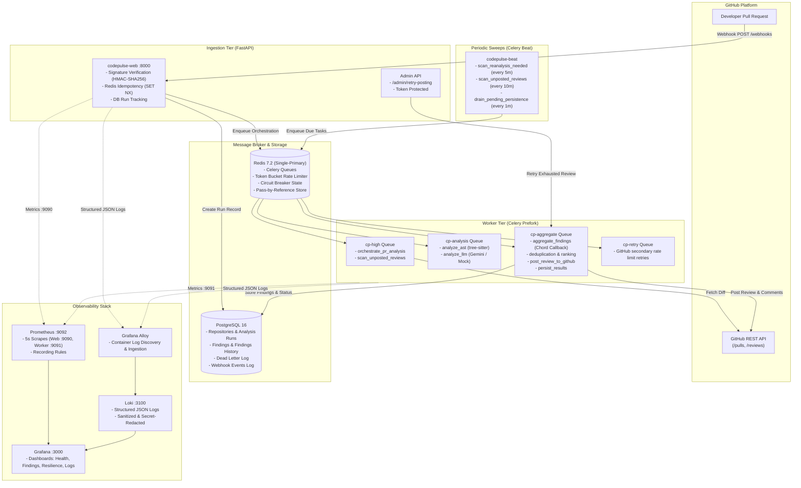
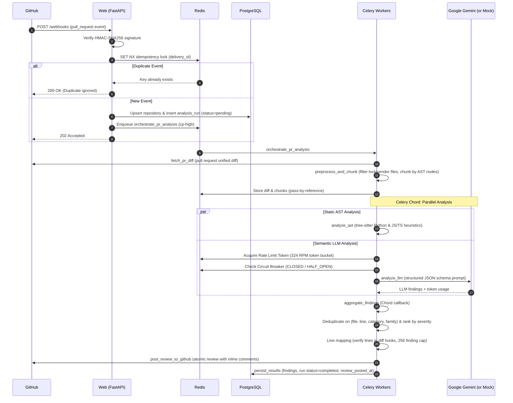

# CodePulse AI

**Automated GitHub Pull Request code reviewer that catches security vulnerabilities and memory leaks before they reach production.**

CodePulse AI is an enterprise-grade automated review bot for GitHub Pull Requests. It combines deterministic static analysis (AST pattern matching via tree-sitter) with deep semantic reasoning via Google Gemini (`gemini-3.7-flash` and `gemini-2.5-pro`). When a pull request is opened or updated, CodePulse analyzes the modified code chunks in parallel, deduplicates and ranks findings, and posts structured inline comments and a summary review directly to GitHub.

---

## Architecture Diagrams

### 1. System Overview



---

### 2. PR-to-Review Sequence



---

### 3. Failure & Graceful Degradation Paths

```mermaid
flowchart TD
    START["Analysis Triggered"] --> DIFF["Fetch PR Diff"]

    DIFF -->|Network error / 5xx| RETRY_DIFF["Retry (exp backoff, max 3)"]
    RETRY_DIFF -->|Exhausted| DLQ_DIFF["Branch C: Dead-Letter Log\n- Record task in dead_letter_log\n- Set analysis_runs.status = 'failed'"]

    DIFF -->|Success| CHORD["Parallel Analysis (Chord)"]
    
    subgraph GeminiBreaker ["Branch D: Gemini API Resiliency"]
        CHORD --> CHECK_CB{"Circuit Breaker\nState?"}
        CHECK_CB -->|OPEN| DEG_AST["Graceful Degradation to AST-Only\n- Skip LLM analysis\n- Mark reanalysis_needed = true\n- Append §6.4 degraded note to review"]
        CHECK_CB -->|CLOSED / HALF_OPEN| RL_CHECK{"Rate Limiter\nToken Available?"}
        RL_CHECK -->|No token| RL_RETRY["Retry countdown (jittered)"]
        RL_RETRY -->|Exceeds 60s deadline| DEG_AST
        RL_CHECK -->|Token granted| CALL_GEMINI["Execute Gemini API Call"]
        CALL_GEMINI -->|5 consecutive failures| TRIP["Trip Circuit Breaker to OPEN\n(30s recovery timeout)"]
        TRIP --> DEG_AST
        CALL_GEMINI -->|Success| MERGE
    end

    DEG_AST --> MERGE["Aggregate & Deduplicate Findings"]
    
    MERGE --> POST["Post Review to GitHub"]

    subgraph GitHubPosting ["Branch F: Review Posting Resiliency"]
        POST -->|422 Unprocessable (line outside diff)| FALLBACK_422["Fallback to Top-Level Body\n- Convert comments to bullet list\n- Post review with comments = []"]
        POST -->|GitHub 5xx / connection error| RETRY_POST["Retry (exp backoff, max 5)"]
        RETRY_POST -->|Exhausted| DLQ_POST["Branch F: Durable Dead-Letter Persistence\n- Persist review payload in dead_letter_log\n- Keep findings in Postgres\n- analysis_runs.review_posted_at = NULL"]
    end

    subgraph DatabaseRecovery ["Branch G: PostgreSQL Outage Resiliency"]
        POST --> PERSIST["Persist Findings & Run Status"]
        PERSIST -->|Database connection failure| REDIS_BUFFER["Buffer to Redis Queue\n'codepulse:pending_persistence'"]
    end

    subgraph PeriodicRecovery ["Celery Beat Periodic Sweeps"]
        DEG_AST -.->|Periodic 5m sweep| BEAT_REANALYZE["tasks.scan_reanalysis_needed\n- Checks breaker CLOSED\n- Checks PR head SHA unchanged\n- Runs LLM & posts follow-up review\n- Clears reanalysis_needed = false"]
        DLQ_POST -.->|Periodic 10m sweep or Admin API| BEAT_REPOST["tasks.scan_unposted_reviews\n- Loads durable Branch F payload\n- Checks PR head SHA unchanged\n- Posts review & sets review_posted_at\n- Marks dead_letter_log resolved = true"]
        REDIS_BUFFER -.->|Periodic 1m sweep| BEAT_DRAIN["tasks.drain_pending_persistence\n- Replays buffered findings into PostgreSQL"]
    end
```

---

## System Implementation & Verification Status

| Subsystem / Feature | Implemented | Verified with Mocks | Verified Live | Status / Architecture Notes |
| :--- | :---: | :---: | :---: | :--- |
| **Ingestion Service (FastAPI)** | ✅ | ✅ | 🔲 | HMAC-SHA256 signature verification, idempotency locks, repo upsert. Live GitHub delivery pending. |
| **AST Analysis Engine (tree-sitter)** | ✅ | ✅ | N/A | 17 heuristic rules across Python and JavaScript/TypeScript. Deterministic AST parsing. |
| **LLM Analysis Engine (Gemini)** | ✅ | ✅ | 🔲 | Structured output via `google-genai` SDK and `MockLLMClient`. Live Gemini API credentials pending. |
| **Deduplication & Ranking** | ✅ | ✅ | N/A | Deduplication on `(file, line, category, family)`. 256 finding cap preserving all criticals. |
| **GitHub Review Client** | ✅ | ✅ | 🔲 | RS256 JWT generation, token exchange, atomic reviews. MockGitHubPoster verified; live API pending. |
| **Celery Pipeline & Worker Service** | ✅ | ✅ | N/A | Prefork workers on dedicated queues (`cp-high`, `cp-analysis`, `cp-aggregate`, `cp-retry`). |
| **Rate Limiter (Gemini)** | ✅ | ✅ | N/A | Redis Lua token bucket (324 RPM, burst 10) with jittered retries and wait deadline degradation. |
| **Circuit Breakers (Gemini & GitHub)** | ✅ | ✅ | 🔲 | Spec §6.3 circuit breakers for both Gemini and outbound GitHub calls (diff fetch & review post) with failure window, recovery timeout, and `codepulse_circuit_breaker_state{api="gemini|github"}` metrics. |
| **Graceful Degradation (§6.4)** | ✅ | ✅ | N/A | Degrades to AST-only when breaker OPEN or deadline exceeded; auto-recovered by Celery Beat sweep. |
| **Dead-Letter Handling & Admin Retry** | ✅ | ✅ | N/A | Durable review payloads stored in `dead_letter_log`; retryable via Beat or `POST /admin/retry-posting`. |
| **Observability (Metrics & Dashboards)** | ✅ | ✅ | N/A | Prometheus v3 scraping isolated internal ports (9090, 9091) + 4 provisioned Grafana dashboards. |
| **Observability (Logs & Redaction)** | ✅ | ✅ | N/A | Structured JSON logs shipped to Loki v3 via Alloy; automated secret & diff redactor in pipeline. |
| **Observability (Distributed Tracing)** | ✅ | ✅ | N/A | OpenTelemetry SDK instrumentation with W3C Trace Context across web and Celery workers, Tempo v3 backend, and Grafana trace-to-logs integration. |
| **Kubernetes Deployment (Helm)** | ✅ | ✅ (Lint & Schema) | 🔲 | Production Helm v3 chart in `deploy/helm/codepulse` with KEDA autoscaling, Ingress security, NetworkPolicies, and migration hook. Lint- and schema-checked only; never deployed to a live cluster. |
| **Redis Architecture** | ✅ | ✅ | N/A | **Spec Deviation (DEC-016):** Single-primary Redis replaces Redis Cluster because Celery does not support Cluster. |

---

## Quick Start (Fresh Machine)

### Prerequisites
- **Docker & Docker Compose** (Docker Desktop on macOS/Windows, or Docker Engine 24+ on Linux)
- **Python 3.12+** (for running client test scripts on host, optional)
- **curl** and **jq** (for testing endpoints and metrics)

### 1. Clone & Configure
```bash
git clone https://github.com/bearAtharv/codepulse-ai.git
cd codepulse-ai

# Copy development template
cp .env.example .env
```
*(In mock mode, all default credentials in `.env.example` function out of the box for local development).*

### 2. Launch the Application Stack
```bash
docker compose up -d --build
docker compose ps
```

Verify service readiness:
```bash
curl -i http://127.0.0.1:8000/health/ready
```
Expected output: `HTTP/1.1 200 OK` with `{"status":"ready","database":"healthy","redis":"healthy"}`.

### 3. Send a Test Pull Request Webhook
Use the built-in CLI utility to send a valid, HMAC-signed webhook event:

```bash
python3 scripts/send_test_webhook.py --repo "my-org/demo-repo" --pr 42
```
Expected output:
```
[*] Target URL: http://127.0.0.1:8000/webhooks
[*] Event: pull_request (opened)
[*] Repository: my-org/demo-repo | PR: #42
[*] Signature: sha256=... [REDACTED]
[+] Response Status: 202 Accepted
```

Inspect worker execution logs:
```bash
docker compose logs --tail=20 worker
```

Inspect database records:
```bash
docker compose exec postgres psql -U codepulse -d codepulse -c \
  "SELECT id, status, review_posted_at, github_review_id, total_findings FROM analysis_runs ORDER BY created_at DESC LIMIT 1;"
```

### 4. Access Observability Dashboards
- **Grafana**: [http://127.0.0.1:3000](http://127.0.0.1:3000) (Default user: `admin`, password from `.env`)
  - *Dashboards included:* Pipeline Health, Findings & LLM, Resilience & Errors, Application Logs.
- **Prometheus UI**: [http://127.0.0.1:9092](http://127.0.0.1:9092)

### 5. Run the Test Suite
Run unit, integration, and contract tests inside the isolated container:
```bash
docker compose run --rm web pytest
```
Or on the host with Python 3.12+:
```bash
PYTHONPATH=src pytest
```

---

## Kubernetes Deployment (Helm Chart)

The production-grade Helm v3 chart is located at `deploy/helm/codepulse`.

> [!NOTE]
> **Validation Notice:** This chart is lint- and schema-checked only (`helm lint` and `kubeconform`). It has not been deployed to a live Kubernetes cluster.

### Features
- **Deployments:** Separated deployments for `ingestion` (FastAPI), queue-dedicated Celery workers (`worker-high`, `worker-analysis`, `worker-aggregate`, `worker-retry`, `worker-dlq`), `beat` (1 replica with `strategy.type: Recreate`), and `admin` API.
- **Resource Limits & Requests:** Configured strictly per §8.2 (`ingestion` 250m/256Mi, `analysis` 500m/512Mi, etc.). Unspecified pool limits are documented judgment calls.
- **Autoscaling:** KEDA `ScaledObject` templates with Redis list-length triggers matching §4.4 (`cp-high` > 50, `cp-analysis` > 100, `cp-aggregate` > 30), 10s polling, and 300s scale-down stabilization window. Ingestion autoscales via HPA on 60% CPU.
- **Ingress Security:** Ingress exposes strictly `/webhooks` and `/health` paths. Internal management (`/admin`) and Prometheus endpoints (`/metrics`) are never exposed externally.
- **NetworkPolicies:** Tight ingress and egress rules isolating ingestion and worker pods, restricting egress to Redis, PostgreSQL, Tempo (4318), and HTTPS (443) for GitHub and Gemini APIs.
- **Migration Hook:** Pre-install and pre-upgrade Helm Hook Job executing `alembic upgrade head`.
- **Secrets:** Clean templates with placeholder values and optional Bitnami `SealedSecret` support.

### Validation Commands
```bash
# 1. Lint the chart
helm lint deploy/helm/codepulse

# 2. Render templates with default and production values
helm template codepulse deploy/helm/codepulse > /tmp/rendered.yaml
helm template codepulse deploy/helm/codepulse -f deploy/helm/codepulse/values-prod.yaml > /tmp/rendered-prod.yaml

# 3. Schema validation with kubeconform
kubeconform -summary -schema-location default \
  -schema-location 'https://raw.githubusercontent.com/datreeio/CRDs-catalog/main/{{.Group}}/{{.ResourceKind}}_{{.ResourceAPIVersion}}.json' \
  /tmp/rendered.yaml
```


---

## Known Limitations & Architecture Decisions

All non-trivial engineering trade-offs, deviations from early draft specifications, and architectural judgments are recorded in [DECISIONS.md](file:///Users/bear/SDE/CodePulse/DECISIONS.md). Key items include:

1. **Redis Cluster vs Single-Primary Redis (DEC-016):**
   - *Draft spec called for Redis Cluster.*
   - *Limitation:* The Celery Redis broker transport explicitly does not support Redis Cluster topology (Redis Cluster does not support cross-slot multi-key atomic transactions and `BLPOP` primitives required by Celery).
   - *Resolution:* CodePulse AI deploys a dedicated, high-performance single-primary Redis 7.2 instance with Redis persistence (`appendonly yes`).
2. **Table Partitioning Deferred (DEC-001):**
   - PostgreSQL table partitioning on `analysis_runs` is deferred until database sizing benchmarks warrant partition maintenance overhead.
3. **Graceful Degradation Formatting & Follow-Up Comments (DEC-014):**
   - Section 6.4 exact phrasing is used: `"LLM analysis unavailable; AST-only results shown. Re-analysis will be triggered automatically when the service recovers."`
   - Rendered as a GitHub blockquote with a warning badge. Re-analysis follow-up posts a single updated comment rather than replacing original reviews.
4. **Rate Limit Wait Deadline (DEC-015):**
   - If accumulated retry delays under severe Gemini API throttling exceed `GEMINI_RATE_LIMIT_DEADLINE` (default 60s), the analysis gracefully degrades to AST-only to prevent worker thread starvation.
5. **Circuit Breaker Half-Open Transience (DEC-025):**
   - The probe request in `HALF_OPEN` state executes in tens of milliseconds before returning to `CLOSED`. Due to Prometheus pull scrape intervals (5s), time-series graphs typically reflect a direct step between `1.0` (OPEN) and `0.0` (CLOSED). Redis (`circuit:gemini:state`) is the authoritative source.
6. **Alloy Docker Socket Mount (DEC-021):**
   - Grafana Alloy container socket mount (`/var/run/docker.sock:ro`) is used as a local Compose development convenience; Kubernetes deployments will use DaemonSets reading `/var/log/pods`.

---

## Reference Documentation

- [docs/LIVE_SMOKE_TEST.md](file:///Users/bear/SDE/CodePulse/docs/LIVE_SMOKE_TEST.md): Detailed, step-by-step human runbook for Stage 1 (Mock LLM + Live GitHub) and Stage 2 (Live Gemini + Live GitHub) smoke tests against real cloud APIs.
- [DECISIONS.md](file:///Users/bear/SDE/CodePulse/DECISIONS.md): Complete architecture decision records (DEC-001 through DEC-025).
- [codepulse_ai_architecture.md](file:///Users/bear/SDE/CodePulse/codepulse_ai_architecture.md): Upstream foundational architecture specifications.

---

## License

**License not chosen.** All rights reserved. Proprietary and confidential until an official open-source license is designated.
